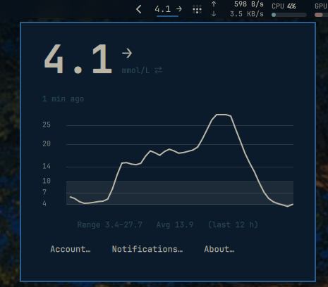
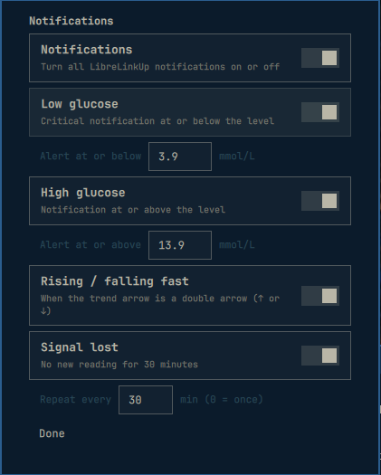
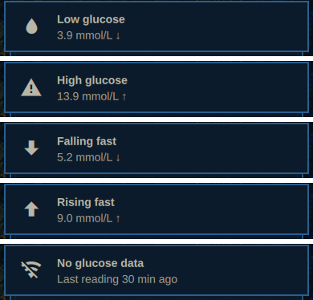

# omarchy-librelinkup

A bar widget for the [Omarchy](https://omarchy.org/) shell that shows your
blood glucose from **LibreLinkUp**: the current value and trend arrow in the
bar, and a 12-hour graph in a popup.

> **Not a medical device.** This is a convenience display. Do not use it for
> treatment or dosing decisions. It is not affiliated with or endorsed by
> Abbott. It uses the unofficial LibreView follower API, which can change or
> break without notice, and use may be subject to Abbott's terms.



## Features

- Value and trend arrow (`5.8 →`) in the bar; turns the bar's urgent colour
  when low or high; `?` appended when the reading is over 15 minutes old.
- Popup with large reading, age, 12-hour graph with your target range shaded,
  and range / average.
- Click the unit label in the popup to switch between mg/dL and mmol/L; the
  graph axis follows. The choice is remembered.
- Sign in from the popup itself, no config file editing (**Account…**).
- Notifications (with an icon per alert) for low glucose, high glucose, rising/falling fast, and lost
  signal, each with its own toggle, thresholds in your chosen unit, a repeat
  interval, and a master off switch (**Notifications…**).
- **About…** panel with version, licence and links.
- Left-click opens the popup, middle-click refreshes, `r` refreshes in the popup.

The notifications panel: a master switch, per-alert toggles, thresholds in your
chosen unit, and a repeat interval.



Each alert has its own icon: low, high, falling fast, rising fast and no data.



## Install

```bash
omarchy plugin add https://github.com/aurora7795/omarchy-librelinkup --enable
```

Or clone into `~/.config/omarchy/plugins/aurora7795.librelinkup/` and run
`omarchy plugin enable aurora7795.librelinkup --section right`.

Requires `python3` (standard library only). `secret-tool` (libsecret) is used for password storage when available. Then click the widget and sign in.

## Remove

```bash
omarchy plugin remove aurora7795.librelinkup
```

That removes the plugin and its bar entry. Your data is stored separately and
is left in place; to delete it too:

```bash
secret-tool clear service omarchy-librelinkup   # the saved password
rm -rf ~/.config/librelinkup ~/.cache/librelinkup
```

## Sign in

Use the **LibreLinkUp follower** account that your Libre app shares with, not
the sensor owner's login. If LibreLinkUp asks you to accept new terms, do that
in the phone app first.

## Where things are stored

| File | Contents |
|---|---|
| System keyring (Secret Service, via `secret-tool`) | your password, under the attribute `service=omarchy-librelinkup` |
| `~/.config/librelinkup/config.json` | email, unit, notification settings (permissions 600) |
| `~/.cache/librelinkup/session.json` | cached session token (permissions 600) |

Notifications are sent with `omarchy-notification-send`. They depend on this widget,
the unofficial API and your connection, so do not rely on them as a safety alarm.

If no keyring is available (no Secret Service, or `secret-tool` missing), the
widget falls back to storing the password **in plain text** in `config.json`
(permissions 600) and says so in the Account panel. An existing plain-text
password is moved into the keyring automatically the first time the widget
runs, and only removed from the file after it has been read back successfully.

The password is passed to the helper through an environment variable, never on
the command line. Nothing is sent anywhere except LibreView
(`api*.libreview.io`).

## Settings

In the widget's entry in `~/.config/omarchy/shell.json`:

| Key | Default | |
|---|---|---|
| `intervalSec` | `60` | refresh interval, 60 to 600 |
| `unit` | `"mgdl"` | default unit; the popup's choice overrides it |

## Files

- `manifest.json`: plugin manifest
- `BarWidget.qml`: the bar pill
- `Panel.qml`: data polling, popup, sign-in form, graph
- `llu.py`: LibreLinkUp client (login, region redirect, token cache, fetch)

## License

MIT, Copyright (c) 2026 Martin Bradford Gago
